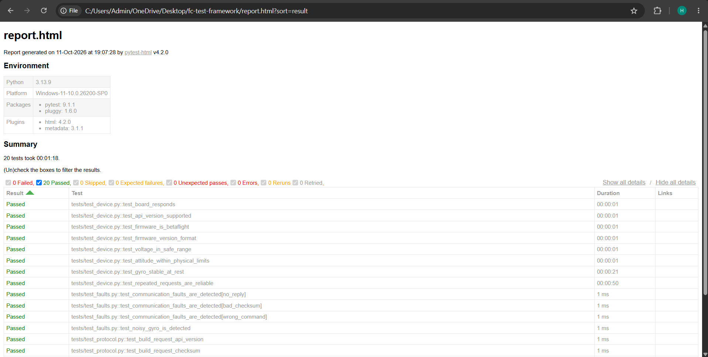

# Flight Controller Test Automation Framework


A Python test framework that automatically validates drone flight controllers over USB. It talks to Betaflight boards using the MSP binary protocol, runs hardware checks with pytest, and produces HTML test reports. A built-in device simulator with fault injection lets the full suite run without hardware, including in CI.



## Features

- **MSP protocol client:** builds requests and validates every reply (header, command, length, checksum) before trusting the data
- **Automatic device detection:** finds the board by USB vendor/product ID instead of a hard-coded COM port
- **Hardware test suite:** firmware identity and version, API compatibility, battery voltage range, attitude limits, gyro stability at rest, and reliability over repeated requests
- **Device simulator:** a software flight controller that speaks MSP, so tests run anywhere
- **Fault injection:** the simulator can drop replies, corrupt checksums, answer the wrong command, or produce a noisy gyro, proving the tests catch real failures
- **HTML reports:** pass/fail for every check, with a clear reason for each failure
- **CI:** GitHub Actions runs the suite on every push and stores the report

## Running the tests

```bash
pip install -r requirements.txt

pytest -v                                   # against the simulator
pytest -v --hardware                        # against a real board (auto-detected)
pytest -v --hardware --port COM7            # or pick the port yourself
pytest -v --hardware --html=report.html --self-contained-html
```

Hardware tests need the board connected over USB, with no battery or props, kept still on a flat surface.

## Test coverage

| Area | What is checked |
|------|-----------------|
| Protocol | Request encoding, reply validation, rejection of empty, truncated, corrupted and mismatched replies |
| Identity | Board responds, firmware is Betaflight, version format, API version ≥ 1.46 |
| Power | Voltage within the safe 0–26 V range |
| Sensors | Attitude within physical limits, gyro stable at rest (< 2° variation) |
| Reliability | 50 consecutive requests answered correctly |
| Fault detection | Missing replies, bad checksums, wrong commands and noisy sensors are all caught |

## Project structure

```
msp_client.py   MSP protocol client and device detection
simulator.py    Simulated flight controller with fault injection
checks.py       Shared measurements (sensor stability)
conftest.py     pytest setup: --hardware switch and fixtures
tests/          Protocol, device and fault-detection tests
```

## Tested with

Flywoo GOKU F7 Pro V2, Betaflight 4.5.1, MSP API 1.46.